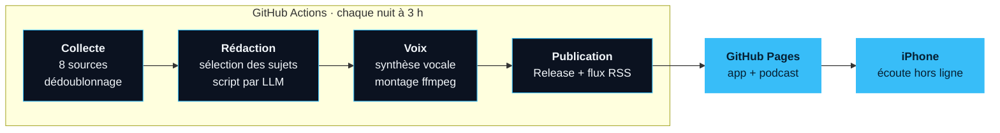

[README.md](https://github.com/user-attachments/files/33504094/README.md)
<div align="center">


# CyberVeille

**Ma veille cybersécurité du jour, en podcast, générée automatiquement chaque nuit.**

[](https://github.com/elpokito/appcyberveille/actions/workflows/daily-episode.yml)
[](https://github.com/elpokito/appcyberveille/actions/workflows/tests.yml)

[](LICENSE)

[**Ouvrir l'app**](https://elpokito.github.io/appcyberveille/) ·
[Flux podcast](https://elpokito.github.io/appcyberveille/feed.xml) ·
[Fonctionnement](#fonctionnement) ·
[Sécurité](#sécurité) ·
[Problèmes rencontrés](#problèmes-rencontrés)

</div>

<br>

## Le projet

Je passe environ une heure par jour dans les transports. J'avais envie d'en profiter pour suivre l'actu cyber,
mais lire des flux RSS debout dans le métro, ce n'est pas pratique.

J'ai donc construit un pipeline qui, **chaque nuit**, récupère les news, choisit les sujets importants, écrit un
script en français, le fait lire par une voix de synthèse et le publie dans une petite app installée sur mon iPhone.
Le matin, l'épisode est là, et je l'écoute **hors ligne**.

Contrainte fixée dès le départ : **0 € de budget**. Tout tourne sur des offres gratuites.

<!--
  Captures d'écran : ajoute tes images dans docs/screenshots/ puis décommente ce bloc.
<div align="center">
  
  &nbsp;&nbsp;
  
  &nbsp;&nbsp;
  
</div>
-->

<br>

<table>
  <tr>
    <td align="center"><b>8</b><br><sub>sources suivies</sub></td>
    <td align="center"><b>50 – 70</b><br><sub>news analysées / jour</sub></td>
    <td align="center"><b>~20</b><br><sub>sujets par épisode</sub></td>
    <td align="center"><b>15 – 20 min</b><br><sub>d'écoute</sub></td>
    <td align="center"><b>~7 min</b><br><sub>d'exécution</sub></td>
    <td align="center"><b>0 €</b><br><sub>de coût</sub></td>
  </tr>
</table>

<br>

## Fonctionnement



| Étape | Fichier | Ce qu'elle fait |
| :-- | :-- | :-- |
| **1. Collecte** | `src/collect.py` | Lit les flux des dernières 48 h, nettoie le HTML, retire le tracking des URL, dédoublonne par URL et par titre. `data/seen.json` évite de réentendre une news. |
| **2. Rédaction** | `src/generate.py` | Un « rédacteur en chef » (LLM) regroupe les articles d'un même événement, écarte la pub et l'opinion, note chaque sujet de 1 à 5. Le texte est ensuite rédigé rubrique par rubrique. |
| **3. Voix** | `src/tts.py` | Adapte le texte à l'oral (CVE, sigles, scores CVSS), synthèse avec edge-tts, assemblage ffmpeg, chapitres dans le MP3, volume normalisé à -16 LUFS. |
| **4. Publication** | `src/publish.py` | Envoie le MP3 dans une Release GitHub, régénère le flux RSS, met à jour la liste des épisodes. |
| **5. App** | `docs/` | PWA en JavaScript sans framework : lecteur, chapitres, vitesse, reprise, et 7 derniers épisodes disponibles hors ligne. |

<br>

## Stack

| Domaine | Outils |
| :-- | :-- |
| Langage | Python 3.12, JavaScript (sans framework) |
| IA | Groq (`gpt-oss-120b`), OpenRouter en secours |
| Audio | edge-tts, ffmpeg |
| Infrastructure | GitHub Actions, GitHub Releases, GitHub Pages |
| Qualité | pytest (20 tests), Dependabot |

<br>

## Choix techniques

<table>
  <tr>
    <td width="30%"><b>Une PWA plutôt qu'une app native</b></td>
    <td>L'App Store coûte 99 $/an et demande un Mac. La PWA s'installe depuis Safari, fonctionne hors ligne grâce à un service worker, et se partage avec un simple lien.</td>
  </tr>
  <tr>
    <td><b>Groq plutôt que Gemini</b></td>
    <td>L'offre gratuite de Gemini n'est pas utilisable pour des utilisateurs en Europe. Si Groq ne répond pas, le script bascule seul sur des modèles gratuits d'OpenRouter.</td>
  </tr>
  <tr>
    <td><b>Plusieurs petits appels au LLM</b></td>
    <td>Ma première version envoyait tout d'un coup : texte trois fois trop court, JSON cassé, quota dépassé. Découper le travail a réglé les trois.</td>
  </tr>
  <tr>
    <td><b>Ne jamais faire confiance au LLM</b></td>
    <td>Chaque passage cite ses sources, et le code vérifie que chaque CVE mentionnée y existe vraiment. Sinon, le passage est réécrit, puis supprimé. Mieux vaut une news en moins qu'une fausse CVE.</td>
  </tr>
  <tr>
    <td><b>GitHub comme seule infrastructure</b></td>
    <td>Actions pour l'exécution, Releases pour les MP3, Pages pour l'app. Aucun serveur à maintenir, aucune carte bancaire.</td>
  </tr>
</table>

<br>

## Sécurité

C'est un projet de cyber, j'ai donc essayé d'appliquer ce que j'apprends en cours.

| Risque | Ce que j'ai mis en place |
| :-- | :-- |
| Fuite de clé API | Clés uniquement dans GitHub Secrets (et un `.env` ignoré en local). Secret scanning et push protection activés. |
| Droits excessifs en CI | Chaque workflow déclare ses seules permissions. Les tests sont en lecture seule, seul le déploiement peut publier. |
| Injection de prompt | Les articles sont transmis au LLM comme des données délimitées, avec consigne de ne jamais suivre leurs instructions. |
| XSS dans l'app | Les titres venant des flux sont insérés comme du texte, jamais comme du HTML. Liens `http(s)` uniquement, CSP stricte. |
| Hallucinations | Contrôle automatique des CVE citées, passages fautifs écartés. |
| Vie privée | Aucun compte, aucun cookie, aucun traceur. La progression reste sur le téléphone. |
| Dépendances | Versions épinglées, mises à jour proposées par Dependabot. |

<br>

## Problèmes rencontrés

La partie qui m'a le plus appris.

<details>
<summary><b>Les avis du CERT-FR disparaissaient sans erreur</b></summary>
<br>

Le CERT-FR date ses avis à minuit, sans heure. Avec une fenêtre de 24 h et un lancement à 3 h, un avis publié à
15 h était déjà « trop vieux » le lendemain. Rien ne plantait, des news étaient juste perdues en silence.
Je l'ai trouvé en affichant l'âge de chaque entrée.
**Solution :** fenêtre de 48 h, et c'est la mémoire `seen.json` qui évite les doublons.
</details>

<details>
<summary><b>Le premier épisode ratait les sujets importants</b></summary>
<br>

En analysant ce qui avait été retenu, j'ai vu que le Patch Tuesday et une faille notée CVSS 10 étaient passés à la
trappe au profit d'articles d'opinion : le tri se faisait par date, pas par importance.
**Solution :** l'étape « rédacteur en chef », qui choisit par importance, avec un plan de secours sans IA.
</details>

<details>
<summary><b>La même faille lue deux fois</b></summary>
<br>

Une vulnérabilité remontée à la fois par la CISA et par la presse finissait dans deux paquets différents.
**Solution :** regrouper les articles d'un même événement en un seul sujet avant la rédaction.
</details>

<details>
<summary><b>Quota de Groq dépassé (HTTP 429)</b></summary>
<br>

L'offre gratuite autorise 8 000 tokens par minute, vite atteints.
**Solution :** un compteur qui mémorise la consommation de la dernière minute et attend avant d'envoyer une
requête trop grosse, plutôt que de se faire refuser.
</details>

<details>
<summary><b>Le modèle de secours est devenu payant du jour au lendemain</b></summary>
<br>

**Solution :** plusieurs modèles gratuits essayés dans l'ordre, configurables sans toucher au code.
</details>

<details>
<summary><b>Une clé API exposée</b></summary>
<br>

Au début du projet, j'en ai collé une là où il ne fallait pas. Je l'ai révoquée et recréée.
**Depuis :** une clé par usage (une pour GitHub, une pour mon PC), uniquement dans les Secrets.
</details>

<br>

## Structure du dépôt

```
appcyberveille/
├── src/
│   ├── collect.py        collecte et dédoublonnage
│   ├── generate.py       sélection des sujets et rédaction (LLM)
│   ├── tts.py            synthèse vocale et montage audio
│   ├── publish.py        Release GitHub, flux RSS, liste des épisodes
│   └── common.py         utilitaires partagés
├── docs/                 l'app : HTML, CSS, JS, service worker, icônes
├── tests/                tests automatiques (sans réseau ni clé API)
├── data/                 mémoire du pipeline
└── .github/              workflows et Dependabot
```

<br>

## Lancer le projet

<details>
<summary><b>Sur GitHub</b> (utilisation quotidienne)</summary>
<br>

1. Forker le dépôt.
2. Ajouter les secrets `GROQ_API_KEY` et `OPENROUTER_API_KEY` dans *Settings → Secrets and variables → Actions*.
   Optionnel : `NTFY_TOPIC` pour une notification sur le téléphone en cas d'échec.
3. *Settings → Pages* : source **GitHub Actions**.
4. *Actions → Épisode quotidien → Run workflow*.
</details>

<details>
<summary><b>En local</b> (Windows)</summary>
<br>

```bash
py -m pip install -r requirements.txt -r requirements-dev.txt
winget install Gyan.FFmpeg

py src/collect.py
py src/generate.py            # clés lues dans un fichier .env
py src/tts.py
py src/publish.py --dry-run   # aperçu du flux, sans rien publier

py -m pytest -q tests
```
</details>

<br>

## Ce que j'ai appris

- Concevoir un pipeline de bout en bout, avec des étapes qui échouent proprement et une alerte quand ça casse.
- Utiliser un LLM dans un vrai produit : découper les tâches, contrôler ses réponses, gérer les quotas.
- GitHub Actions, Pages, Releases, et la gestion des secrets dans une CI.
- Les bases d'une PWA : service worker, cache, lecture audio hors ligne avec les requêtes `Range`.
- Appliquer concrètement des notions vues en cours : moindre privilège, XSS, CSP, injection de prompt.

J'ai développé ce projet avec l'aide d'un assistant IA, utilisé comme binôme pour explorer des pistes, écrire
une première version du code et relire. Les choix, les tests sur mes vraies données et le débogage des problèmes
ci-dessus, c'est moi. Je peux expliquer chaque partie du code.

<br>

## Pistes d'amélioration

- [ ] Améliorer la prononciation des noms de produits et des sigles
- [ ] Voix de secours hors ligne (Piper) si edge-tts tombe
- [ ] Enrichir les CVE avec le score officiel de la NVD
- [ ] Un récap hebdomadaire le samedi
- [ ] Épingler les GitHub Actions par empreinte (SHA)

<br>

---

<div align="center">

<sub>Les résumés sont générés automatiquement par IA à partir de sources publiques et peuvent contenir des erreurs.<br>
Vérifiez toujours l'information à la source, dont le lien accompagne chaque épisode.</sub>

<br><br>

Projet réalisé pendant ma 2e année de bachelor cybersécurité.<br>
[LinkedIn](https://www.linkedin.com/in/charles-sana/)

<sub>Licence [AGPL-3.0](LICENSE)</sub>

</div>
